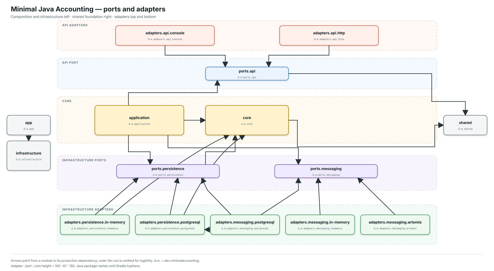

# Module dependencies

The architectural levels run from external API adapters at the top to
infrastructure adapters at the bottom. `app` and its neutral technical
`infrastructure` are deliberately grouped at the left. `shared.ports` provides
the common boundary vocabulary used by the implementation, while `app` and its
factories compose concrete runtime graphs. The diagram shows only the durable
adapter set and omits `app` fan-out plus some repetitive model or shared-port
arrows so the capability arrows remain readable.

[](ARCHITECTURE.svg)

The diagram keeps Gradle modules as solid boxes and shows logical ports as dashed
ports. `api`, `persistence`, and `messaging` remain meaningful architectural
boundaries even though their interfaces are typed uses of generic contracts
from the grey `shared.ports` module rather than separate Gradle subprojects.
Hollow triangle arrows identify implementations of those logical interfaces;
filled arrows identify ordinary use or module dependencies. Cylinders identify
external systems rather than modules. Box height
communicates architectural weight: adapters are 100 units high, ports are 67
units, and model, application, or technical-infrastructure modules are 150
units. `d.m.` abbreviates `dev.minimalaccounting`; Java package names omit
Gradle hyphens.

The durable selection has one adapter for each logical infrastructure port.
`adapters.messaging.outbox` implements messaging as one boundary spanning
transactional PostgreSQL staging and Artemis delivery.
The logical persistence port depends on the model types it stores and
reconstructs; `adapters.persistence.postgresql` acquires that relationship by
implementing the port. Both durable adapters use the neutral
`shared.adapters.postgresql` technical foundation; neither feature adapter
depends on the other. The shared module remains visible without its ordinary
dependency arrows to reduce noise. Filled arrows from both adapters to the
PostgreSQL cylinder show their direct JDBC use.

Inside the `app` module, app-local adapter factories are grouped as
`app.adapters.real` or `app.adapters.fake`. These are composition packages, not
additional modules or adapter implementations. Both expose common component
contracts to the overall factory, so choosing a runtime does not introduce
implementation switches throughout the object graph.

Application handlers receive one composed wrapper from outer composition and
apply it at creation time. Fake composition contributes an identity wrapper;
durable composition contributes the shared JDBC transaction boundary. This is
internal wiring within `app` and does not add a module or logical port.

The infrastructure factory also supplies type-preserving sender and receiver
wrappers to the selected messaging factory. Each messaging factory applies the
wrappers where it creates the corresponding port view, while retaining its raw
duplex queue or topic only for adapter-specific routing and lifecycle. The
overall factory therefore consumes already-decorated messaging components
without repeating every sender and receiver.

Regenerate the checked-in image with:

```shell
./gradlew renderArchitecture
```

## Direct production project dependencies

| Module | Direct project dependencies |
|---|---|
| `shared.ports` | — |
| `model` | — |
| `application` | `model`, `shared.ports` |
| `infrastructure` | `shared.ports` |
| `shared.adapters.postgresql` | `shared.ports` |
| `adapters.api.console` | `model`, `shared.ports` |
| `adapters.api.http` | `model`, `shared.ports` |
| `adapters.persistence.in-memory` | `model`, `shared.ports` |
| `adapters.persistence.postgresql` | `model`, `shared.ports`, `shared.adapters.postgresql` |
| `adapters.messaging.in-memory` | `shared.ports` |
| `adapters.messaging.outbox` | `shared.ports`, `shared.adapters.postgresql` |
| `app` | `shared.ports`, `infrastructure`, `application`, `model`, and all adapters |

Composition injects one `JdbcTransactions` context from
`shared.adapters.postgresql` into the repository and outbox adapters. That lets
repository changes and outbox inserts commit atomically without creating an
adapter-to-adapter dependency. The outbox adapter still implements the generic
messaging contracts and does not add messaging behavior to repositories.

`shared.ports` supplies the generic technical vocabulary: handlers, senders,
receivers, deliveries, repositories, and transaction boundaries. Domain
repositories use its `Repository<Identifier, Aggregate>` shape directly. The
`infrastructure` module consumes that vocabulary to provide JDK logging,
metrics, snapshots, and JMX decorators; `app` alone selects and composes
implementations.

An API adapter translates an external representation into the model
`SubmitTransaction` command and invokes `Handler<SubmitTransaction>`. An
infrastructure adapter implements a shared port for a concrete technology.
Application handlers implement use cases behind those boundaries; they are not
adapters. No adapter owns aggregate state transitions, and nothing depends on
`app`.
