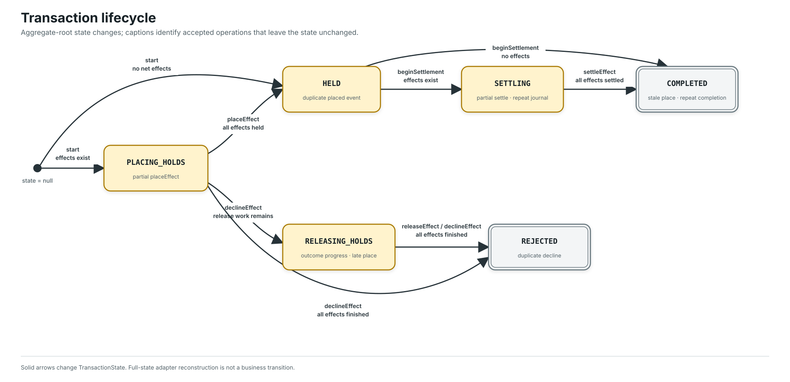
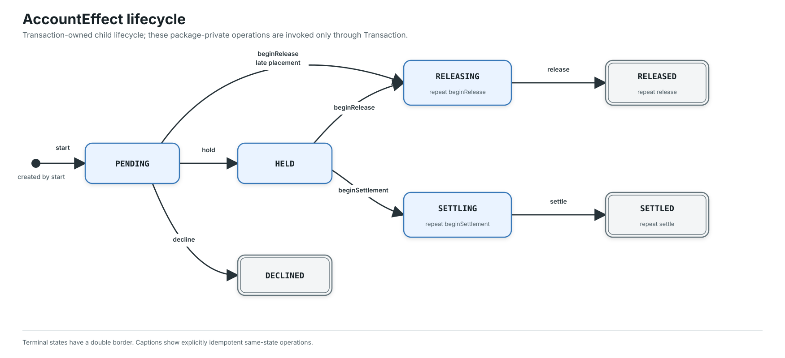
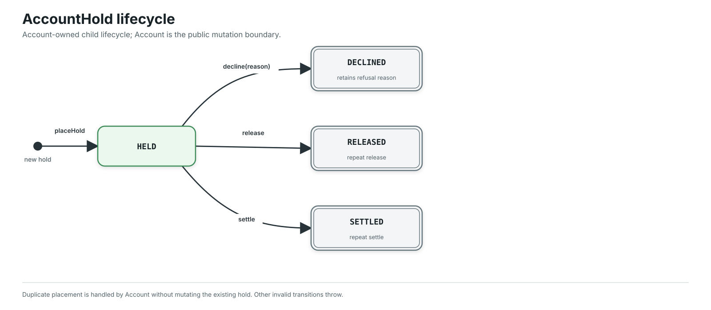

# State transitions

The core has three explicit lifecycle enums. `Transaction` is an aggregate
root; `AccountEffect` and `AccountHold` are owned entities whose business
transitions remain behind their aggregate roots. `Account` and `JournalEntry`
have mutable business data but no finite lifecycle state, so no artificial
state machine is drawn for them.

The diagrams show business transitions, not full-state reconstruction by a
persistence adapter. A double border marks a terminal state. Captions inside a
state call out important duplicate, stale, or partial operations that leave the
state unchanged. Invalid or contradictory transitions throw.

## Transaction



`TransactionState` governs the workflow coordinated by
`TransactionProcessManager`. A decline may pass through `RELEASING_HOLDS`, or
finish directly in `REJECTED` when no release work remains. A transaction whose
lines net to no account effects starts in `HELD` and completes directly when it
is journalized.

## Account effect



Every effect starts as `PENDING` when `Transaction.start` derives it. The child
owns its local transition validation, while package-private visibility ensures
only the `Transaction` aggregate root can invoke those transitions. The root
owns effects in a sorted map keyed by account number; map order is deterministic
and does not add sequencing to the lifecycle.

## Account hold



`Account.placeHold` creates the owned hold in `HELD` and may immediately decline
it when account policy rejects the reservation. Existing hold identity makes
placement, release, and settlement retries idempotent without reopening a
terminal hold. Within one account, the transaction ID is the hold identity.

## Regeneration

The SVG files are generated deterministically by the dependency-free custom
renderer:

```shell
./gradlew renderStateTransitions
```

The authoritative source is
[`tools/render-state-transitions.mjs`](tools/render-state-transitions.mjs).
